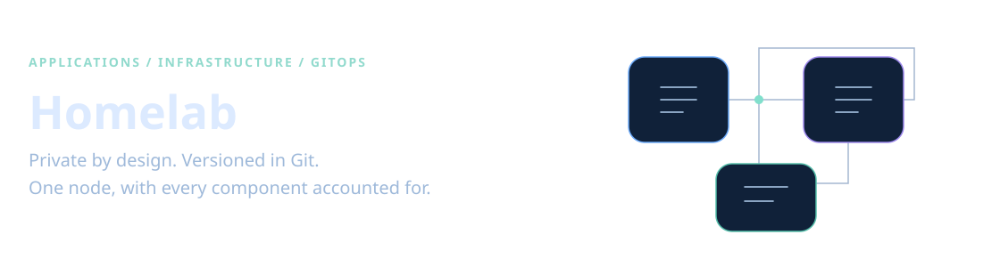
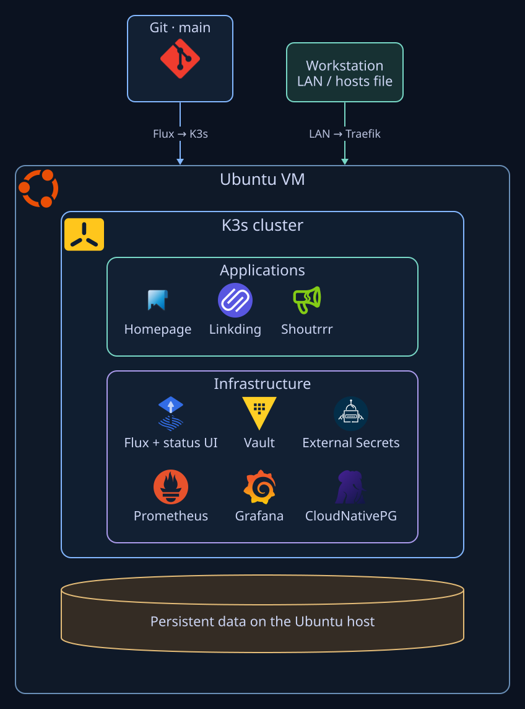
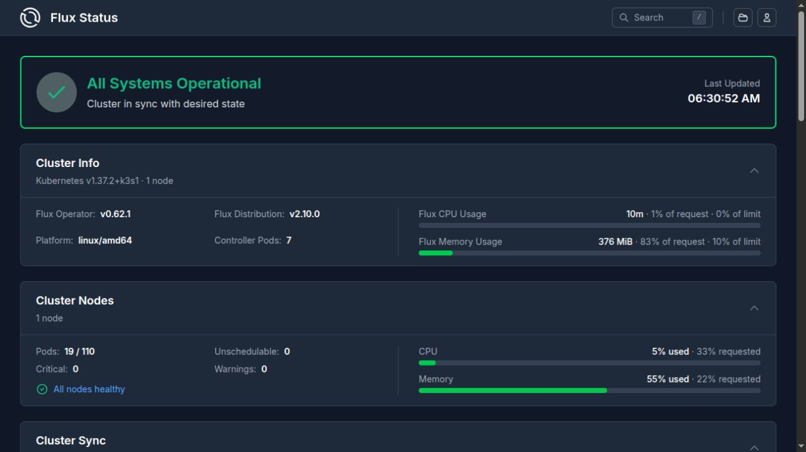

<p align="center">
  
</p>

<p align="center">
  <a href="docs/architecture/platform.md"></a>
  <a href="docs/gitops/reconciliation.md"></a>
  <a href="docs/gitops/repository-structure.md"></a>
  <a href="iac/vault/README.md"></a>
  <a href="docs/infrastructure/vault.md"></a>
</p>

<p align="center">
  <a href="https://hyp3r00t.github.io/homelab/">Documentation</a> ·
  <a href="docs/architecture/index.md">Architecture</a> ·
  <a href="docs/setup/index.md">Setup guide</a> ·
  <a href="docs/runbooks/index.md">Runbooks</a>
</p>

# Homelab

A single-node Ubuntu K3s homelab with private LAN services and a Shoutrrr-only HTTPS tunnel, managed through Flux, Kustomize, and Helm. Built around a small VM—4 vCPUs and approximately 5.28 GiB RAM—with explicit ownership, dependency-aware reconciliation, and persistent data that has a recovery plan.

## The architecture

[](docs/assets/diagrams/architecture.svg)

[Open the architecture diagram at full size](docs/assets/diagrams/architecture.svg).

The diagram describes the **declared configuration**, not live availability. Homepage and Linkding reconcile independently. Shoutrrr and CloudNativePG are included through dependency-ordered groups; Shoutrrr uses SQLite and requires Vault credentials and first-owner registration. Cloudflared publishes only Shoutrrr over HTTPS; the other application and administrative interfaces remain on the private LAN.

## What this project demonstrates

| Area | Engineering choice | Explore |
| --- | --- | --- |
| GitOps | One environment, individual resource files, and explicit readiness boundaries instead of duplicated overlays | [Reconciliation](docs/gitops/reconciliation.md) |
| Platform | K3s owns its packaged ingress, load balancing, DNS, storage, and live metrics; Flux does not install duplicates | [Platform](docs/architecture/platform.md) |
| Secrets | Public references in Git, private values in Vault, Terraform-managed authentication, and ESO delivery | [Secret flow](docs/architecture/secrets-flow.md) |
| Persistence | Retained volumes for Vault and Shoutrrr data, with explicit limits and recovery responsibilities | [Storage recovery](docs/runbooks/storage-recovery.md) |
| Access | Private LAN ingress and workstation hostname mappings, without a public tunnel or LAN DNS server | [Local access](docs/setup/local-access.md) |

## Applications

Tools used directly for everyday work:

| Application | Purpose | Configuration |
| --- | --- | --- |
| [Homepage](docs/apps/homepage.md) | Personal start page and resource overview | Included |
| [Linkding](docs/apps/linkding.md) | Private bookmark collection | Included |
| [Shoutrrr](docs/apps/shoutrrr.md) | Social publishing and scheduling trial | Vault credentials and first-owner registration required |

## Infrastructure

Administrative and shared capabilities support those applications. Flux reconciles Git, and Vault and External Secrets deliver credentials. K3s supplies ingress, DNS, service load balancing, local storage provisioning, and current resource metrics.

A browser interface does not make an administrative tool an end-user application. The [infrastructure inventory](docs/infrastructure/index.md) explains ownership and setup, including CloudNativePG database management and the optional, disabled Cloudflared tunnel. Homepage exposes selected shortcuts; it is not a list of every controller or collector.



*Point-in-time Flux UI capture. Controller status complements individual reconciliation and secret-readiness checks; it is not proof that every application has completed bootstrap.*

## Reproduce and operate it

Start with the [ordered setup guide](docs/setup/index.md). It covers the workstation and K3s baseline, Flux bootstrap, hosts-file access, application initialization, and the Vault credential chain. Installing a pod is only one stage: Linkding needs an owner account on a fresh installation, and Vault needs initialization, unsealing, authentication configuration, and secret values.

| Location | Responsibility |
| --- | --- |
| `gitops/apps/<component>/` | End-user application manifests and configuration |
| `gitops/infrastructure/<component>/` | Administrative and shared capabilities |
| `gitops/clusters/lab/` | Flux entrypoint and readiness dependencies |
| `iac/vault/` | Vault authentication, KV mount, policies, and role |
| `docs/` | Architecture, setup, component reference, and operations |

Flux watches `main`; pushing a feature branch does not deploy it. The manifests are the source of declared state. Use the [rollout checks](docs/runbooks/gitops-rollout.md) to verify the live cluster.

## Keep it maintainable

Each Kubernetes object has its own named YAML file. Removed deployment experiments live in Git history rather than an archive tree. New components belong to Applications or Infrastructure and gain a separate Flux group only when they need an independent lifecycle or readiness boundary.

Architecture assets use editable [D2](https://d2lang.com/) sources and the pinned D2 CLI. The helper bundles local service icons into self-contained SVGs:

```shell
mise install d2
mise exec -- python3 .agents/skills/update-architecture-diagram/scripts/render-diagrams.py
mise exec -- python3 .agents/skills/update-architecture-diagram/scripts/render-diagrams.py --check
```

The repository's `update-architecture-diagram` skill can inspect structural changes and update those sources and assets when explicitly invoked. It does not deploy resources. See the [architecture guide](docs/architecture/index.md) and [component workflow](docs/gitops/adding-a-service.md).

Local persistence is not a backup. Retain does not protect against host disk loss or K3s uninstall, and Linkding's existing volume retains its original policy. Secret values, unseal shares, Terraform state, and application data stay outside this public repository.
