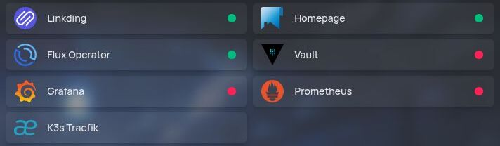

# Homepage

Homepage is the personal entry point to the homelab: shortcuts to applications and administrative tools, endpoint checks, and current CPU/memory readings. It runs as a single deployment using `ghcr.io/gethomepage/homepage:v2.7.0` in the `homepage` namespace.

| Property | Configuration |
| --- | --- |
| Owner | Flux apps group |
| Activation | Included, independent of Vault |
| Browser access | `http://homepage.homelab.internal` |
| Manifests | `gitops/apps/homepage` |
| Application configuration | `gitops/apps/homepage/configs` |
| Persistent application data | None; configuration comes from Git and logs are temporary |

## Configuration

Configure [local hostname access](../setup/local-access.md), wait for the deployment, and open the dashboard. No application account-creation step is declared. Review the static cards, external links, weather location, and bookmarks in `configs/` for your own use rather than treating this personal layout as a universal default.

The Kustomization generates a ConfigMap from the individual settings, service, widget, bookmark, CSS, and JavaScript files. A content change updates the generated name and triggers a deployment rollout. There is no Docker Compose preview or second deployment mechanism.

## Resource visibility

The Kubernetes information widget reads cluster and node CPU/memory through [Metrics Server](../infrastructure/metrics-server.md). Cards use explicit namespaces and pod selectors for application readings. Linkding selects `app=linkding`; Homepage selects `app.kubernetes.io/name=homepage`. HTTP site checks indicate endpoint availability separately from pod resource readings.

The resource view is live, not historical. [Grafana and Prometheus](../infrastructure/kube-prometheus-stack.md) supply history once monitoring is ready. Their configured Homepage links may show unavailable while Vault or monitoring bootstrap is unfinished. Postiz and Cloudflared are not advertised as running.

Ingress discovery is disabled to avoid duplicate cards. Traefik's card shows pod readings rather than calling a separately exposed dashboard API.

## Dashboard example



*Point-in-time capture: Linkding, Homepage, and Flux respond, while Vault and monitoring checks show unfinished bootstrap. Endpoint checks and per-pod resource readings answer different questions; a configured card is not proof its service is ready.*

## Verify

```shell
kubectl -n homepage rollout status deployment/homepage
kubectl -n homepage get pods,service,ingress
kubectl top pods -n homepage
```

Expect the deployment Ready, a matching Ingress, and resource readings once Metrics Server has collected them. If the page loads but a card fails, check that card's target component before treating it as a Homepage deployment failure.

See the [official Homepage documentation](https://gethomepage.dev/) for supported widgets and configuration options.
