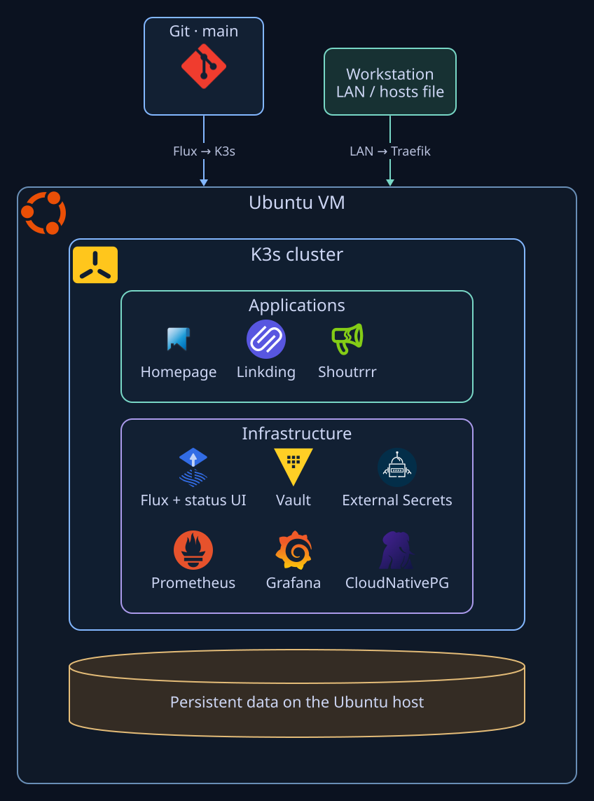

# Architecture

The homelab separates **Applications**, which people use directly, from **Infrastructure**, which supports and administers them. Both run on one Ubuntu VM. K3s owns its packaged components; Flux owns the additional declared resources.

[Open the architecture diagram at full size](../assets/diagrams/architecture.svg).

Solid connectors show configuration or request flow. The secret flow and storage relationships are called out separately; a dependency does not mean that one component owns another's data. Inactive components are outside the enabled node configuration.

## Read the system by boundary

| Question | Explanation |
| --- | --- |
| What does the node run, and who owns it? | [Platform](platform.md) |
| How does a browser reach an application? | [Traffic flow](traffic-flow.md) |
| How do credentials reach workloads? | [Secrets flow](secrets-flow.md) |
| Why is monitoring waiting for Vault? | [Reconciliation](../gitops/reconciliation.md) |
| What survives a pod restart or a reinstall? | [Storage recovery](../runbooks/storage-recovery.md) |

Use [Applications](../apps/index.md) and [Infrastructure](../infrastructure/index.md) for the component details. Use [Setup](../setup/index.md) for the first-install journey rather than inferring installation order from this overview.
