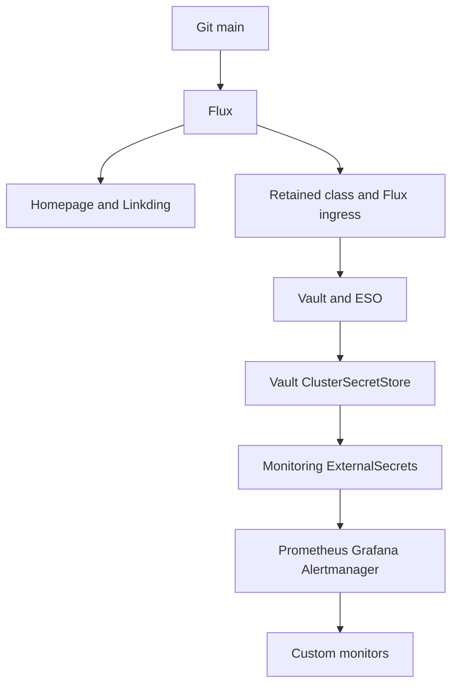

# Platform architecture

The two service areas are apps for end-user applications and infrastructure for administrative and shared platform services. Monitoring lives under infrastructure/kube-prometheus-stack. Each shared component has one owner. K3s owns packaged platform components; Flux does not redeclare their deployments.

Arrows after Flux indicate readiness dependencies, not ownership of the downstream data. Apps do not wait for Vault, so a sealed Vault or unfinished bootstrap does not block Homepage and Linkding updates. Core infrastructure does not wait for monitoring, so Flux UI remains available while diagnosing bootstrap failures.

Cloudflared, CloudNativePG, and Postiz have service directories but no active reconciliation entry. Operators and their custom resources are kept on opposite sides of a readiness boundary when needed. See [reconciliation](../gitops/reconciliation.md).
