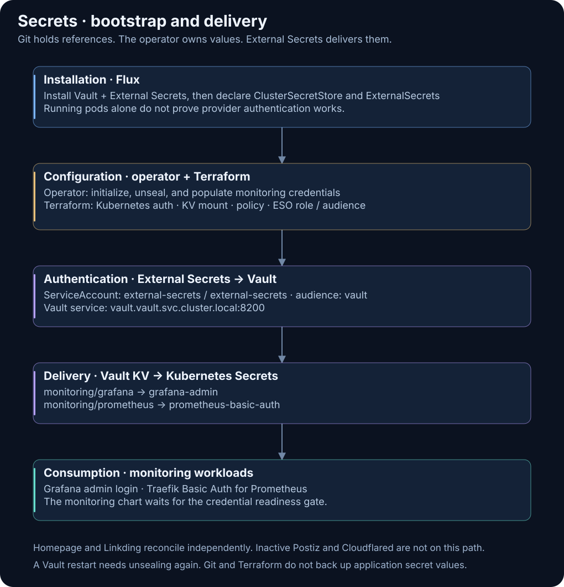

# Secrets flow

Git holds secret references, not their values. Vault stores credential values, External Secrets authenticates using Kubernetes identity, and the resulting namespaced Kubernetes Secrets are consumed by workloads.

## Installation is only the first step

| Responsibility | Owner |
| --- | --- |
| Install Vault and External Secrets | Flux secrets group |
| Initialize and unseal Vault | Operator |
| Configure Kubernetes authentication, the KV mount, policy, and role | Terraform under `iac/vault` |
| Choose and preserve credential values in private tfvars | Operator |
| Populate Shoutrrr and monitoring credential records | Terraform under `iac/vault` |
| Read approved Vault paths and synchronize Kubernetes Secrets | External Secrets |
| Consume the delivered Secrets | Shoutrrr, Grafana, and the Prometheus ingress middleware |

The `vault` ClusterSecretStore authenticates at `auth/kubernetes` using role `eso`, the `external-secrets` service account, and audience `vault`. It reads the `external-secrets` KV v2 mount. The service address `http://vault.vault.svc.cluster.local:8200` uses Kubernetes DNS and does not depend on the workstation hosts file.

## The monitoring gate

A running Vault pod can still be sealed or uninitialized. Until authentication and the required values work, the secret store and monitoring credentials remain unready. Flux waits at those boundaries before installing the monitoring chart. Homepage and Linkding are independent of this chain.

Follow [Vault bootstrap](../runbooks/vault-bootstrap.md), then verify the [monitoring credentials](../infrastructure/kube-prometheus-stack.md#credentials). Terraform creates the Vault configuration and writes the three credential records from sensitive private inputs. It does not manage application-generated OAuth tokens.

## Secret ownership

The operator owns credential values and recovery material. A manifest reference or an available token does not grant automation permission to read or mutate secrets. Keep `.env`, Terraform inputs/state/plans, unseal keys, and Raft snapshots outside the public repository. Use the [recovery runbook](../runbooks/vault-recovery.md) when the cluster or Terraform state changes.

Shoutrrr has its own ExternalSecrets and waits for the same secret store independently of monitoring. Shoutrrr stores its runtime provider tokens in SQLite, encrypted using its stable APP_KEY; Terraform cannot recreate that application data. The disabled Cloudflared bundle retains its separate credential reference.
