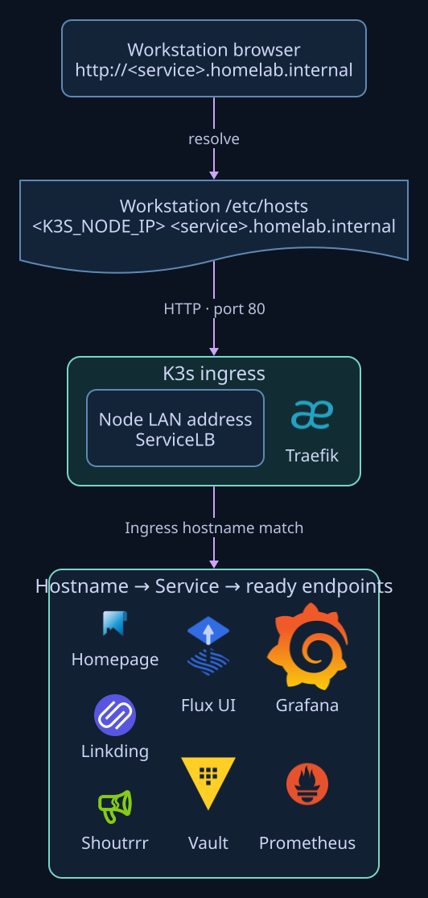

# Traffic flow

Browser access is private over the LAN. Without a LAN DNS server, each workstation maps the internal hostnames to the K3s node's current LAN address in its own `/etc/hosts` file. That mapping is local to the workstation; it does not change DNS for other devices.

The connection reaches the node on the requested port. K3s ServiceLB makes the Traefik LoadBalancer service available, and Traefik matches the HTTP hostname to an Ingress. The current application interfaces use HTTP; port 443 being available on Traefik does not mean certificates or HTTPS have been configured for every route.

## Where requests go

| Hostname | Destination | Access condition |
| --- | --- | --- |
| `homepage.homelab.internal` | Homepage | Included application |
| `linkding.homelab.internal` | Linkding | Owner account required |
| `flux.homelab.internal` | Flux Operator's embedded web UI | Included core ingress |
| `traefik.homelab.internal` | Existing Traefik dashboard and internal API | Core IngressRoute; open `/dashboard/` |
| `vault.homelab.internal` | Vault | Initialization and unseal required |
| `grafana.homelab.internal` | Grafana | Monitoring credentials and chart ready |
| `prometheus.homelab.internal` | Prometheus | Monitoring ready; Traefik Basic Auth |

Alertmanager is cluster-internal. The Flux UI uses the existing operator service rather than another UI deployment. Hostname resolution does not prove that the destination is ready or provide an authentication boundary.

Follow [Local access](../setup/local-access.md) for the general hosts-file format, a labeled example, and troubleshooting. No public tunnel or Tailscale route is activated here. [Cloudflared](../infrastructure/cloudflared.md) is an inactive option, and private access still depends on the router/firewall not forwarding the LAN ports publicly.
