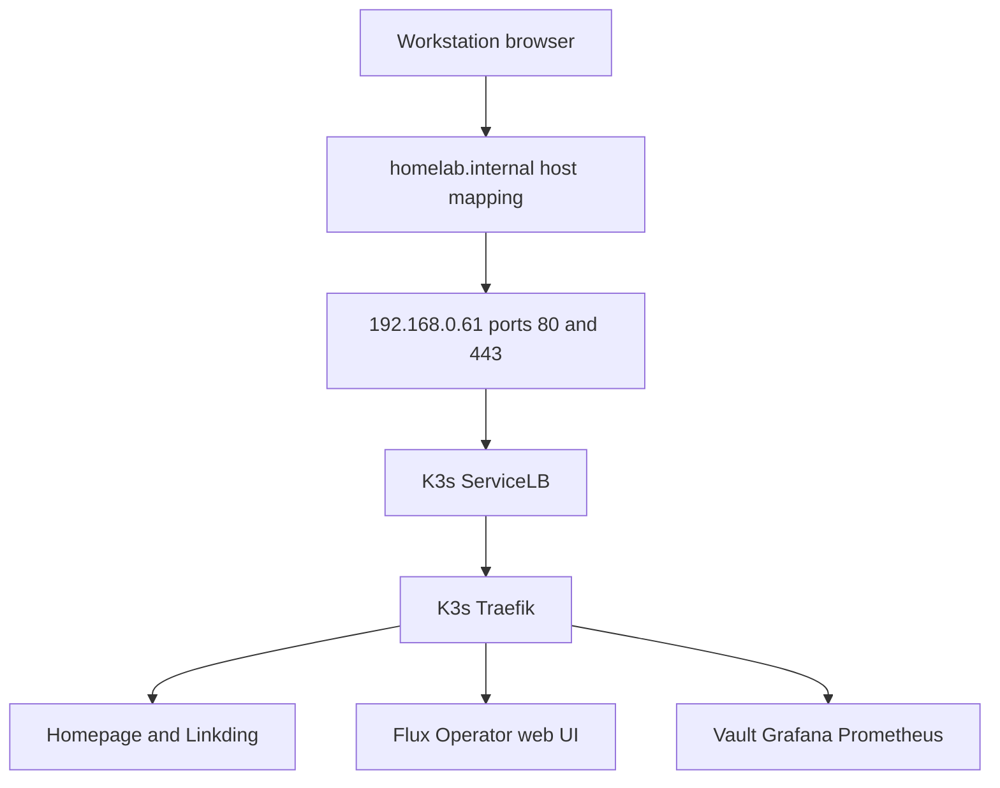

# Traffic flow

Access is private over the LAN. The workstation maps service hostnames to `192.168.0.61` in `/etc/hosts`. The mapping is local to that workstation; it does not configure DNS on other devices.

Ingress resources route by hostname. The Flux UI ingress targets the existing `flux-operator` service on port 9080, with no additional UI deployment. Grafana uses its login, and the Prometheus ingress keeps its Vault-backed Basic Auth middleware. Alertmanager remains cluster-internal.

There is no active public tunnel or Tailscale configuration. The retained [Cloudflared](../services/cloudflared.md) bundle is optional and must be activated separately if public access is deliberately chosen later. Private intent also depends on the router/firewall not forwarding these LAN ports publicly.
