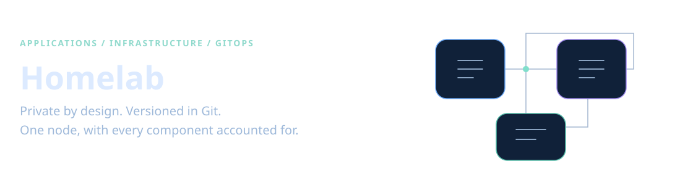
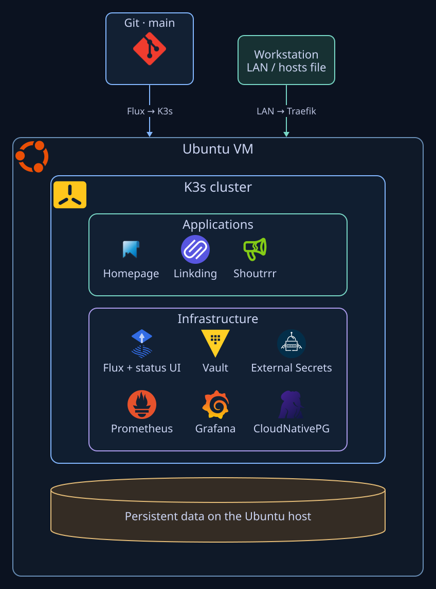
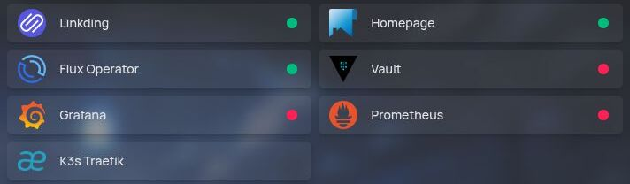

# A small cluster, deliberately built

{ .hero-art }

One Ubuntu VM. A K3s cluster. Applications and infrastructure kept in Git, with clear ownership and room to measure what each workload costs.

[Explore the architecture](architecture/index.md){ .md-button .md-button--primary } [Set up the homelab](setup/index.md){ .md-button }

## The whole system

[Open the architecture diagram at full size](assets/diagrams/architecture.svg).

This is the **declared architecture**, not a live status board. Homepage and Linkding are included independently of Vault. Monitoring is included but waits for Vault bootstrap and credentials. Postiz, CloudNativePG, and Cloudflared are retained without activation.

## Engineering choices

- :lucide-git-branch: **One source of configuration**

    Flux watches `main`. Kustomize assembles individual resource files, and Helm installs the shared components. [Follow reconciliation](gitops/reconciliation.md).

- :lucide-boxes: **One owner for each component**

    K3s supplies ingress, load balancing, DNS, local storage, and live metrics. Flux adds the applications and infrastructure without reinstalling those components. [See the platform boundary](architecture/platform.md).

- :lucide-key-round: **Secrets outside Git**

    Vault holds values, Terraform configures its authentication, and External Secrets delivers Kubernetes Secrets. Manual bootstrap is explicit. [Follow the secret path](architecture/secrets-flow.md).

- :lucide-chart-no-axes-combined: **Resources treated as a budget**

    The reference VM has 4 vCPUs and about 5.28 GiB RAM. Homepage shows current readings; Prometheus and Grafana provide history. [Explore monitoring](infrastructure/kube-prometheus-stack.md).

## A view into the cluster

*Real Homepage capture: application and Flux checks respond, while Vault and monitoring checks reflect unfinished bootstrap. The dashboard shows the distinction instead of treating a configured link as a healthy service.*

[Explore Homepage](apps/homepage.md) or [open the Flux interface example](infrastructure/flux.md#web-ui). Screenshots are selected examples, not live telemetry.

## Find your route

| I want to… | Start here |
| --- | --- |
| Understand how everything fits | [Architecture](architecture/index.md) |
| See the end-user tools | [Applications](apps/index.md) |
| Inspect the administrative components | [Infrastructure](infrastructure/index.md) |
| Build a similar private cluster | [Setup](setup/index.md) |
| Change configuration safely | [GitOps](gitops/index.md) |
| Bootstrap, troubleshoot, or recover | [Runbooks](runbooks/index.md) |

The configuration is the evidence of intended behavior. Use the verification commands in each guide to establish what is actually running.
