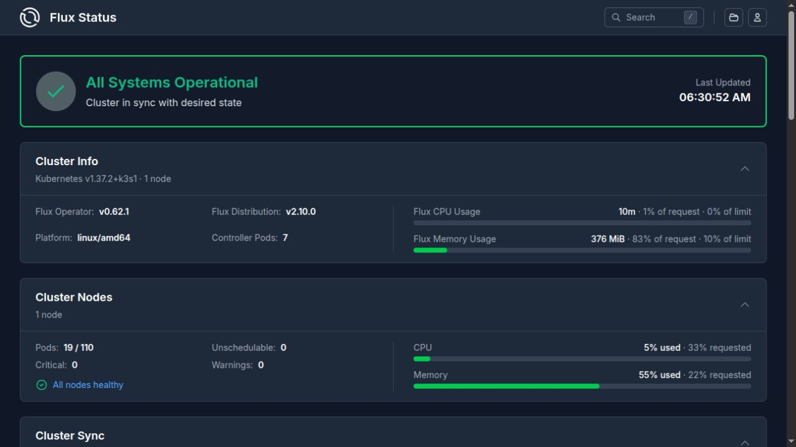

# Flux

Flux continuously compares the declared configuration in Git with the cluster and applies the intended resources. Flux Operator manages the controllers through the checked-in FluxInstance. The instance watches `main` at `gitops/clusters/lab`; it does not deploy arbitrary feature branches.

| Property | Configuration |
| --- | --- |
| Initial operator installation | Operator bootstrap, outside the GitOps tree |
| Managed instance | `gitops/clusters/lab/flux-system/flux-instance.yaml` |
| Reconciliation | Source, Kustomize, Helm, notification, image reflection/automation, source-watcher controllers |
| Status interface | Embedded in Flux Operator; no separate UI deployment or data volume |

## Initial setup

Follow [Flux bootstrap](../setup/flux.md) for a fresh cluster. For an existing cluster, check the source URL, revision, and group readiness before considering another installation. [Reconciliation](../gitops/reconciliation.md) explains the independent apps group and the secret delivery chain.

## Web UI

The core ingress routes `http://flux.homelab.internal` to the operator's `http-web` service port, 9080. Configure [local access](../setup/local-access.md). The included LAN ingress adds no SSO or external identity provider; this is an administrative interface and should remain private.

For temporary workstation access without the hostname mapping:

```shell
kubectl -n flux-system port-forward svc/flux-operator 9080:9080
```

Open `http://localhost:9080`. Review available UI actions when upgrading rather than assuming every operator version has identical capabilities.



*Point-in-time capture: the controller overview complements the resource readiness checks below. An operational controller can still be waiting on a workload's missing credentials or manual bootstrap.*

## Verify

```shell
kubectl -n flux-system get fluxinstance
flux get sources git -A
flux get kustomizations -A
flux get helmreleases -A
```

Check the source revision and each intended group's conditions. A healthy operator or source alone does not prove every application works. See [Flux Operator documentation](https://fluxoperator.dev/docs/) for installation, upgrades, and the UI.
