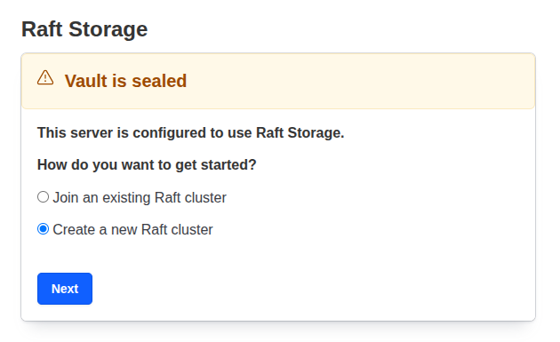
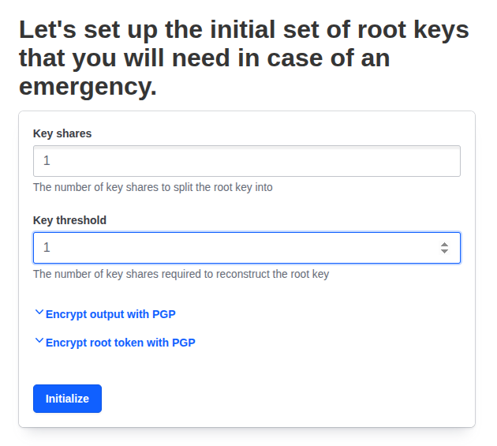
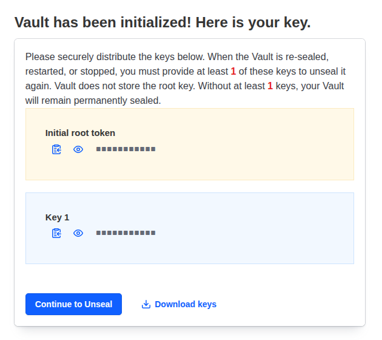
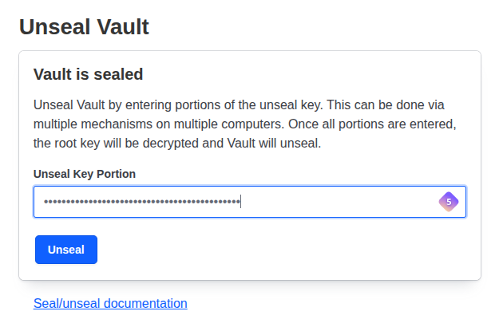
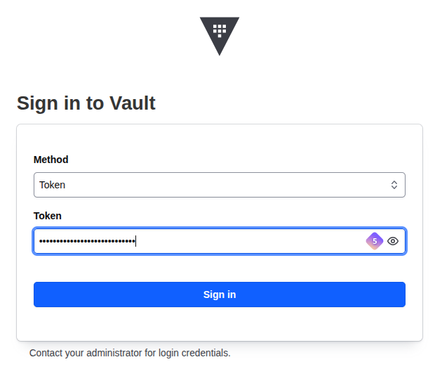
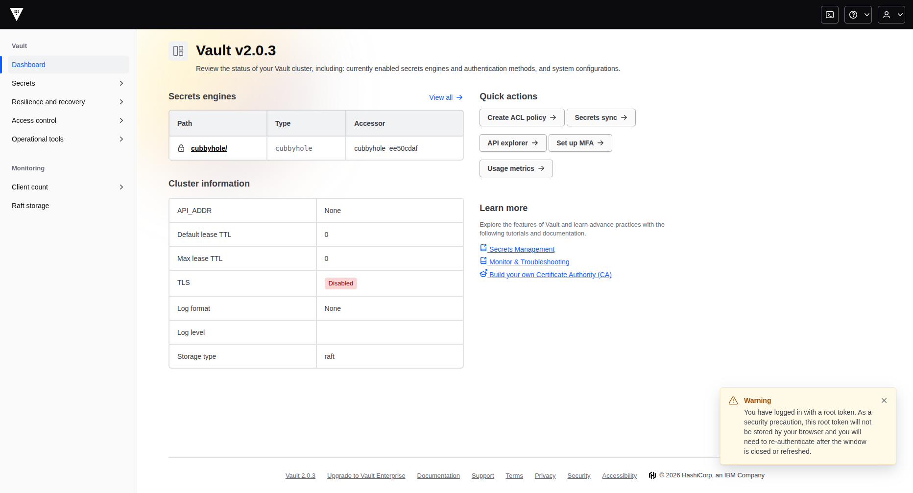

# Bootstrap Vault

This runbook initializes Vault, configures its Kubernetes integration for External Secrets, and supplies the credentials needed to unblock monitoring. Run commands from the workstation at the repository root.

## What this setup creates

Flux deploys Vault, its persistent volume, the External Secrets Operator, and the Kubernetes resources they need. Terraform then configures these objects inside Vault:

- Kubernetes authentication at `kubernetes`
- Kubernetes API authentication using the `vault-token-reviewer` service account
- a KV v2 secrets engine mounted at `external-secrets`
- an `eso` policy with read access to that mount
- an `eso` role for the `external-secrets` service account with audience `vault`, matching the store TokenRequest
- the Shoutrrr, Grafana, and Prometheus credential records, populated from sensitive private inputs

The `ClusterSecretStore` in `gitops/infrastructure/secret-store/cluster-secret-store.yaml` uses those names exactly.

## 1. Check the deployed components

Run these commands on the workstation from the repository root, with the lab Kubernetes context selected and the tools in `mise.toml` installed:

```shell
kubectl config current-context
flux get kustomizations infrastructure secrets
kubectl -n vault get pods
kubectl -n external-secrets get pods
```

Flux must have reconciled `infrastructure` and `secrets`. The secret store and monitoring can remain unready until this bootstrap finishes. A running Vault pod does not mean Vault has been initialized or unsealed.

## 2. Resolve the hostname from the workstation

The shared [local-access guide](../setup/local-access.md) explains all service hostnames and troubleshooting. For Vault, the workstation uses an `/etc/hosts` entry to resolve the internal Vault hostname to the K3s node. Open the file:

```shell
sudoedit /etc/hosts
```

Add `vault.homelab.internal` to the existing entry for the node, or add an entry using this format. Replace `<K3S_NODE_IP>` with the node's current LAN IP address:

```text
<K3S_NODE_IP> vault.homelab.internal

# Example
192.168.0.61 vault.homelab.internal
```

Preserve existing aliases such as `homepage.homelab.internal` and `linkding.homelab.internal`. If the node IP changes, update this entry. Verify resolution:

```shell
getent hosts vault.homelab.internal
kubectl -n vault get ingress vault
```

The hosts entry provides name resolution only on this workstation. The request goes to the node's Traefik ingress, which routes the `vault.homelab.internal` hostname to Vault. Other devices need their own name resolution. External Secrets uses the in-cluster address `http://vault.vault.svc.cluster.local:8200` and does not use the workstation's hosts file.

## 3. Set the Vault address before checking its status

Set the address in the current shell first:

```shell
export VAULT_ADDR=http://vault.homelab.internal
vault status
```

Without `VAULT_ADDR`, the CLI defaults to `https://127.0.0.1:8200`, which targets the workstation instead of the Kubernetes service and can report connection refused.

For subsequent sessions, add this setting to the repository's ignored `.env` file, preserving any existing entries:

```dotenv
VAULT_ADDR=http://vault.homelab.internal
```

`mise.toml` loads this file when the mise environment is active. The explicit `export` above handles the current shell without depending on an environment refresh. Keep `.env` and `iac/vault/terraform.tfvars` outside Git.

## 4. Initialize only a new Vault

Use the `vault status` output to choose the next step:

| Status | Action |
|---|---|
| `Initialized: false` | Initialize, then unseal |
| `Initialized: true`, `Sealed: true` | Skip initialization and use the existing unseal keys |
| `Initialized: true`, `Sealed: false` | Continue to authentication and Terraform configuration |

A sealed Vault makes `vault status` exit with code 2; inspect the displayed fields rather than treating that alone as a connection failure.

Initialize through either the browser or CLI; both prepare the same storage backend. Complete one method only. The screenshots show the owner's first initialization of this single-node Vault with **one key share and a threshold of one**. They are UI captures, not Raft backup snapshots; see [Vault recovery](vault-recovery.md#back-up-vault-data) for actual backups.

### Initialize through the browser

This initializes the existing Vault pod's integrated Raft storage. Kubernetes continues to run the same single Vault instance.

Open `http://vault.homelab.internal/ui/`. On a new Raft-backed installation, select **Create a new Raft cluster** and click **Next**. Joining an existing cluster is a different operation and is not needed for this single-node setup.

[](../assets/images/vault-bootstrap/01-new-raft-cluster.png)

*Choose a new cluster only for an uninitialized storage backend.*

Set **Key shares** and **Key threshold** before clicking **Initialize**:

| Field | Value in this homelab example | Meaning |
| --- | --- | --- |
| Key shares | `1` | Number of unseal shares generated |
| Key threshold | `1` | Number of distinct shares needed to unseal |

[](../assets/images/vault-bootstrap/02-key-shares.png)

*The one-share example matches this owner-operated homelab. It is not a general recommendation for shared or production environments.*

With a one-share threshold, possession of that share is enough to unseal, and losing the only share can prevent future recovery. Choose a different split if your recovery and custody requirements need one; for example, five shares with a threshold of three requires three distinct shares. The threshold cannot exceed the number of shares. This walkthrough leaves the optional PGP encryption sections unused; use the [official PGP guide](https://developer.hashicorp.com/vault/tutorials/archive/pgp-encrypted-key-shares) if choosing encrypted initialization output.

After initialization, Vault displays the **Initial root token** and **Key 1**. Save the root token and all generated unseal shares securely outside the repository before leaving this screen. **Download keys** exports sensitive initialization material; keep that file in private storage, not the project directory. The root token is for authentication; the unseal share unlocks Vault. They are not interchangeable.

[](../assets/images/vault-bootstrap/03-initialized.png)

*This is initialization output, not a database backup. The example keeps both credential values masked.*

Select **Continue to Unseal** after preserving the initialization material. Never initialize an already initialized Vault again.

### CLI alternative

To create the same one-share setup through the CLI instead of the browser, run this only when `Initialized` is `false`:

```shell
vault operator init -key-shares=1 -key-threshold=1
```

Save the unseal share and initial root token securely outside the repository before continuing. For a different custody model, choose the share count and threshold at initialization, such as `-key-shares=5 -key-threshold=3`. These are Shamir unseal shares, not recovery keys for an auto-unseal configuration. Do not run CLI initialization after completing it through the UI. See [Vault initialization](https://developer.hashicorp.com/vault/docs/commands/operator/init) for the options.

## 5. Unseal and authenticate

Initialization leaves Vault sealed. Use the browser or CLI to provide the number of distinct shares required by the threshold chosen during initialization. With the one-share example above, one submission is sufficient; a five-share, threshold-three setup needs three distinct shares.

### Unseal and sign in through the browser

At **Unseal Vault**, paste an unseal share into **Unseal Key Portion** and select **Unseal**. Repeat with distinct shares if your threshold requires more than one. Use the unseal share, not the root token.

[](../assets/images/vault-bootstrap/04-unseal.png)

*Vault accepts shares until the configured threshold is reached. The field remains masked in this example.*

Once unsealed, the UI presents **Sign in to Vault**. Choose **Token**, enter the saved initial root token, and select **Sign in**.

[](../assets/images/vault-bootstrap/05-token-sign-in.png)

*The root token signs in; it does not replace an unseal share.*

The dashboard confirms that the browser session can access Vault. This capture shows the initial state, including `cubbyhole/`, before the repository's Terraform configuration has created the `external-secrets` mount and Kubernetes authentication. Dashboard access alone does not establish that External Secrets or monitoring is ready.

[](../assets/images/vault-bootstrap/06-dashboard.png)

*The screenshot's root-session notice describes browser sign-in behavior. Continue with Terraform configuration below; initialization is only the first part of bootstrap.*

### CLI alternative and verification

If the UI has already unsealed Vault, skip the unseal command and check status. Otherwise, run it once per distinct share required, using the hidden prompt:

```shell
vault operator unseal
```

Check for `Initialized: true` and `Sealed: false`. If using CLI commands that need authentication, log in with the root token at the hidden prompt; signing in to the browser does not authenticate the CLI automatically:

```shell
vault status
vault login
```

The CLI normally caches this token through its local token helper. Terraform below uses its separately configured `vault_token` input; a browser or CLI login does not populate that input. A root token is appropriate for initial bootstrap and recovery; use a narrower administrative token for routine work when possible.

Vault seals again after its pod restarts because this installation has no auto-unseal configuration. Repeat the address setup, unseal, and verification steps after a restart. Initialization and Terraform bootstrap do not need to be repeated solely because of a restart. See [seal and unseal](https://developer.hashicorp.com/vault/docs/concepts/seal) for the lifecycle.

## 6. Prepare Terraform inputs

For a first setup, create the ignored input file from the tracked example. If it already exists, edit it instead of overwriting it:

```shell
umask 077
if [ ! -f iac/vault/terraform.tfvars ]; then
  cp iac/vault/terraform.tfvars.example iac/vault/terraform.tfvars
fi
chmod 600 iac/vault/terraform.tfvars
```

Populate it with:

- `vault_addr`: `http://vault.homelab.internal` (Terraform does not take this input from the CLI export)
- `vault_token`: the initial root token for bootstrap, or an administrative token with the required permissions
- `kubernetes_host`: the Kubernetes API URL reachable from the Vault pod
- `kubernetes_ca_cert`: the cluster CA certificate
- `token_reviewer_jwt`: the token for `vault-token-reviewer`
- `shoutrrr_credentials`: a persistent APP_KEY and optional LinkedIn inputs (see the example generation commands)
- `grafana_credentials`: administrator username and password
- `prometheus_users`: a complete htpasswd bcrypt entry

The example file contains commands for retrieving the Kubernetes values. Its default `kubernetes_host`, `https://kubernetes.default.svc:443`, uses the in-cluster API because Vault runs in this cluster. A reachable node API URL is also valid; do not use a workstation-only localhost proxy address. Keep the reviewer token on a single quoted line. The configured reviewer Secret supplies a long-lived service-account token; a short-lived token from `kubectl create token` would require renewal and an update to Vault's configuration.

Paste the complete CA certificate into the example's heredoc, including its PEM boundary lines. Ordinary double-quoted HCL strings cannot span literal lines:

```hcl
kubernetes_ca_cert = <<-EOT
-----BEGIN CERTIFICATE-----
...paste the complete cluster CA certificate here...
-----END CERTIFICATE-----
EOT
```

The snippet illustrates the format; the placeholder is not a usable certificate. Keep the populated file private and outside Git. Regenerate the CA and reviewer JWT after every Kubernetes reinstall; reusing the old file can cause `403 permission denied` errors from `auth/kubernetes/login`.

Generate the Shoutrrr key once using `openssl rand -base64 32`, prefix it with `base64:`, and paste it into `shoutrrr_credentials.app_key`. Generate the Grafana password once using `openssl rand -hex 32`. For Prometheus, run `htpasswd -nB prometheus` at its hidden password prompt and paste the complete output into `prometheus_users`. The example includes installation instructions if the utility is missing. Save browser credentials in your password manager. Do not regenerate these values during routine applies. The LinkedIn fields can remain empty until provider setup.

If these credential records already exist in Vault outside Terraform, preserve their values and import them first; see the [Shoutrrr](../apps/shoutrrr.md#private-configuration) and [monitoring](../infrastructure/kube-prometheus-stack.md#credentials) guides. Terraform owns the entire contents of each managed record.

## 7. Configure Vault

Initialize providers, review a saved plan, and apply it:

```shell
umask 077
terraform -chdir=iac/vault init
terraform -chdir=iac/vault fmt -check
terraform -chdir=iac/vault validate
terraform -chdir=iac/vault plan -out=tfplan
terraform -chdir=iac/vault apply tfplan
```

Review the plan before running `apply`: a completely new baseline creates eight resources, with no updates or deletions. Providing `cloudflared_credentials` additionally creates its separate tunnel credential record, for nine resources in this deployment. These are the Kubernetes auth mount, its reviewer configuration, the KV mount, the ESO policy, the ESO role, and three credential records. If the original five bootstrap resources are already tracked in state, credential management creates three records. If these already exist from manual setup but the local state is missing, recover the state or import the existing resources first; do not delete them to make the plan succeed. A clean follow-up plan should report no changes:

```shell
terraform -chdir=iac/vault plan
```

The saved plan, variable file, provider directory, and state are ignored by Git. Plans and state can contain sensitive values despite terminal redaction; restrict their permissions and keep any backups in private storage outside Git. Preserve `iac/vault/terraform.tfstate` securely because it is the active Terraform state for this workspace. A Raft snapshot backs up Vault data; it does not replace a backup of the local Terraform state. Delete or regenerate saved plans after changing inputs, and avoid committing JSON exports of plans or state.

## 8. Verify the secret store

Check the Terraform state and the Vault-backed store:

```shell
terraform -chdir=iac/vault plan
kubectl get clustersecretstore vault
```

A healthy result has no Terraform changes and reports the store as ready. If the store is not ready, inspect its status and the External Secrets logs:

```shell
kubectl describe clustersecretstore vault
kubectl -n external-secrets logs deployment/external-secrets --tail=100
```

## 9. Verify the application credentials and rollout

The Terraform apply writes `shoutrrr`, `monitoring/grafana`, and `monitoring/prometheus` in the `external-secrets` mount. External Secrets then synchronizes those records into the Kubernetes Secrets consumed by the applications. You do not need to enter the same values manually in Vault. See [Monitoring credentials](../infrastructure/kube-prometheus-stack.md#credentials) and [Shoutrrr setup](../apps/shoutrrr.md#private-configuration) for ownership and import guidance.

Flux waits in order for the secret store, monitoring secrets, the monitoring Helm release, and finally the additional monitors. Once the dependencies become ready, reconciliation proceeds automatically; do not manually install the chart.

```shell
kubectl get clustersecretstore vault
kubectl -n monitoring get externalsecrets
kubectl -n flux-system get kustomizations
kubectl -n monitoring get helmrelease,pods,pvc
```

Expect the store and both ExternalSecrets to report ready, followed by the `monitoring` and `monitoring-monitors` Kustomizations. If a secret reports an error, inspect its events with `kubectl -n monitoring describe externalsecret grafana-admin` or `kubectl -n monitoring describe externalsecret prometheus-basic-auth`.

Add `grafana.homelab.internal` and `prometheus.homelab.internal` to the workstation's hosts entry for the node's current LAN IP address to open their interfaces. CNPG and Shoutrrr have separate included Flux groups. The Shoutrrr record is managed by this workspace. Shoutrrr allows first-owner registration and disables subsequent public registration by default; social-provider setup remains a separate step. See [Shoutrrr](../apps/shoutrrr.md) before activating the new trial. The separate Cloudflared group additionally needs its tunnel credential and DNS route; see [tunnel setup](cloudflared-tunnel.md).

## Next steps

- Use [Recover Vault](vault-recovery.md) if state or Vault data is lost.
- For the Shoutrrr-only public tunnel, use [Manage Cloudflared credentials in Vault](cloudflared-vault-credentials.md).
